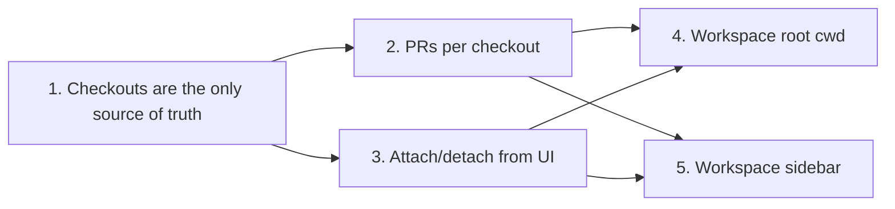

# First-class multi-repo workspaces

Decisions: the agent runs from a **workspace root folder** with one checkout per repo, and the **project sidebar is replaced** by a flat workspace list. Each stage is one PR.

Today `Session.checkouts[]` + `activeCheckoutId` exist (`packages/core/src/session-checkout.ts`), but ~300 reads still use the scalar mirror fields, PRs live on the session, only the agent can attach a repo (`switch_checkout`), and multi-repo sessions land in a fake `__multi_repo__` project.



## Checkouts are the only source of truth <!-- id: checkout-source-of-truth -->

> complexity: high

### Deliverable
`Session` no longer carries the mirror fields (`repo`, `repoPath`, `worktreePath`, `branch`, `baseBranch`, `prNumber`, `githubSlug`, `projectId`, `workspaceMode`); every reader goes through a checkout.

### User story
As a Jingler developer
I want every repo/branch/path read to name its checkout explicitly
So that switching the active checkout can't silently change what an unrelated feature (diff, PR poll, terminal cwd) works on

### Approach
- Move reads to `activeCheckoutOf` / `checkoutById`, file by file, starting with `main/rpc.ts` (116 reads)
- `migrateSessionCheckouts` becomes the decode-time migration; scalars are dropped on the next write
- Plugin SDK keeps `session.repo` / `session.branch` as values derived from the active checkout (public API)

### Steps
- [x] Route `rpc.ts` reads through `resolveCheckoutSession` / `activeCheckoutOf`
- [x] Route `sessions.ts`, `agent-runner.ts`, `workspace-workflow.ts`, `session-title-service.ts`
- [x] Route renderer + `packages/ui` reads (`file-browser-view`, `use-review`, `App`, `conversation-pane`, `session-filters`, `session-row`)
- [x] Derive plugin SDK `repo`/`branch` from the active checkout
- [x] Drop the scalars from the `Session` schema; keep the legacy decode in the session store
- [-] Delete `sessionForCheckout` once nothing uses it

### Technical explanation
`withActive` copies the active checkout onto the session on every reducer action. Two copies drift: `resolveTurnWorktree` calls `SessionStore.setWorktreePath`, which writes the scalar, not the checkout. With one copy there's nothing to drift.

```diff path=apps/desktop/src/main/rpc.ts
-const cwd = session.worktreePath ?? session.repoPath
+const checkout = activeCheckoutOf(session)
+const cwd = checkout.worktreePath ?? checkout.repoPath
```

### Acceptance
- [x] A legacy scalar-only session decodes to one `primary` checkout and is written back without scalars (test[unit]: packages/core/src/session-checkout.test.ts::legacy scalars migrate to primary checkout)
- [x] Healing a worktree path updates the checkout, not a scalar (test[unit]: packages/cli-adapters/src/sessions.test.ts::setWorktreePath updates the active checkout)
- [x] Session create and PR flows still work end to end (test[e2e]: apps/desktop/e2e/projects-and-workspaces.spec.ts::creates an isolated worktree workspace from a selected base branch, apps/desktop/e2e/multi-repo-prs.spec.ts::a multi-repo session shows every checkout's PR labelled with its repo)

### Definition of Done
- `pnpm lint`, `pnpm typecheck`, `pnpm test` green
- `e2e:affected` green
- `rg '\bsession\.(worktreePath|repoPath|branch|prNumber|baseBranch|githubSlug)\b'` only hits the migration

### Files
- `packages/core/src/domain.ts` — M
- `packages/core/src/session-checkout.ts` — M
- `packages/cli-adapters/src/sessions.ts` — M
- `packages/cli-adapters/src/agent-runner.ts` — M
- `packages/cli-adapters/src/workspace-workflow.ts` — M
- `apps/desktop/src/main/rpc.ts` — M
- `packages/plugin-sdk/src/common.ts` — M

## PRs belong to a checkout <!-- id: prs-per-checkout -->

> depends: checkout-source-of-truth
> complexity: medium

### Deliverable
Each checkout owns its PR stack, and every repo's PR is polled, notified and counted for auto-archive.

### User story
As an operator with an api + web workspace
I want both PRs shown with live checks and a notification when either merges
So that the second repo's PR isn't invisible and the workspace archives only when all of its PRs are done

### Approach
- Move `prs`, `prNumber` (top of stack) and `linkedPrs` onto `SessionCheckout`; drop `SessionPr.repo`
- `pr-sweep.ts`, `pr-refresh.ts`, `use-pr-stack.ts` loop over checkouts
- Notify key becomes `sessionId#checkoutId#number`
- `PublishCheckpoint` is stored per checkout so publish can open one PR per repo

### Steps
- [ ] Schema move + decode migration (session `prs` go to the checkout whose `repo` matches, else primary)
- [ ] `pr-sweep` / `pr-refresh` / auto-archive iterate checkouts
- [ ] `use-pr-stack`, `pull-request-pane`, `session-prs-chip` read per checkout
- [ ] Per-checkout publish checkpoint

### Technical explanation
Today `CheckoutHeader` polls a checkout's `prNumber` only when there are 2+ checkouts, and `prsToNotify` only sees the session-level stack, so a merge in the second repo never notifies and never archives.

### Acceptance
- [ ] A merge in checkout B notifies once under B's key (test[unit]: apps/desktop/src/renderer/pr-sweep.test.ts::notifies per checkout)
- [ ] The session archives only after A and B are both merged or closed (test[unit]: apps/desktop/src/renderer/pr-sweep.test.ts::archives when every checkout PR is done)
- [ ] Legacy `prs` with `repo` tags land on the matching checkouts (test[unit]: packages/core/src/session-checkout.test.ts::migrates session prs onto checkouts)

### Definition of Done
- Unit tests above pass
- PR-linking e2e passes
- lint/typecheck/test green

### Files
- `packages/core/src/domain.ts` — M
- `apps/desktop/src/renderer/pr-sweep.ts` — M
- `apps/desktop/src/renderer/pr-refresh.ts` — M
- `apps/desktop/src/renderer/use-pr-stack.ts` — M
- `apps/desktop/src/renderer/pull-request-pane.tsx` — M
- `packages/ui/src/app/session-prs-chip.tsx` — M

## Attach and detach repos from the UI <!-- id: attach-from-ui -->

> depends: checkout-source-of-truth
> complexity: medium

### Deliverable
The operator can create a workspace with several repos and add or remove repos later, without asking the agent.

### User story
As an operator
I want to pick api and web in the new-workspace dialog, or hit "Add repo" in the header later
So that I get a branch per repo without asking the agent to run switch_checkout

### Approach
- One `attachCheckout(sessionId, projectId, branch?)` in `sessions.ts` creates the worktree and runs the `attach` reducer action; the RPC and `switch_checkout` both call it
- `detachCheckout` runs the existing `detach` action and removes the worktree with the same dirty/unpushed check archive uses
- `Sessions.create` takes `projectIds[]`
- The repo picker and header actions compose catalog components; anything missing goes into `packages/ui` + `COMPONENTS.md` first

### Steps
- [ ] `attachCheckout` / `detachCheckout` in `sessions.ts`, contracts and `rpc-client`
- [ ] `switch_checkout` reuses `attachCheckout`
- [ ] Multi-select repo picker in the new-workspace dialog
- [ ] "Add repo" and per-repo "Remove" in `checkout-header.tsx`

### Technical explanation
`switch_checkout` is the only caller of the `attach` action today and nothing calls `detach`, so the reducer already supports this; it just has no UI path.

### Acceptance
- [ ] Attaching the same repo twice re-activates it and never duplicates (test[unit]: packages/cli-adapters/src/sessions.test.ts::attachCheckout is idempotent per repo)
- [ ] Detaching the last checkout is refused; a dirty worktree is kept with `worktreeKeptReason` (test[unit]: packages/cli-adapters/src/sessions.test.ts::detachCheckout keeps dirty worktrees)
- [ ] Create a two-repo workspace, add a third, remove one (test[e2e]: apps/desktop/e2e/multi-repo-workspace.spec.ts::attach and detach repos)

### Definition of Done
- Unit + e2e green
- Storybook stories for the picker and header states

### Files
- `packages/contracts/src/index.ts` — M
- `packages/cli-adapters/src/sessions.ts` — M
- `packages/cli-adapters/src/runtime/tools/checkout-tools.ts` — M
- `apps/desktop/src/main/rpc.ts` — M
- `apps/desktop/src/renderer/rpc-client.ts` — M
- `apps/desktop/src/renderer/checkout-header.tsx` — M
- `apps/desktop/e2e/multi-repo-workspace.spec.ts` — A

## Agent runs from a workspace root <!-- id: workspace-root-cwd -->

> depends: prs-per-checkout, attach-from-ui
> complexity: high

### Deliverable
Every workspace gets `~/jingler/workspaces/<sessionId>/` with one folder per repo, and the agent's cwd is that root.

### User story
As an operator
I want to ask the agent to change the API and update the web client in one turn
So that cross-repo work doesn't need repo switching mid-task

### Approach
- New `AppPaths.workspacesDir`; new worktrees are real `git worktree add`s at `workspacesDir/<sessionId>/<repo>/` (not symlinks, which sandboxed CLIs resolve and refuse to write through)
- Legacy worktrees and direct-mode checkouts stay where they are and are passed as extra writable dirs (claude `--add-dir`, codex writable roots, extra Pi tool roots)
- The root gets a `WORKSPACE.md` mapping each repo to its path
- `agentCwdOf` returns the root; "active checkout" becomes UI focus only
- `switch_checkout` becomes `attach_repo` (no cwd change), with the old name kept as an alias for one release
- `checkoutForPath(session, absPath)` maps file events to a checkout, replacing the `worktreeRoot={session.worktreePath}` prefix checks

### Steps
- [ ] `workspacesDir`, worktree creation under the root, `WORKSPACE.md` writer
- [ ] Extra writable dirs per adapter for out-of-root checkouts
- [ ] `agentCwdOf` returns the root; `resolveTurnWorktree` heals each checkout
- [ ] `checkoutForPath` + move `agent-file-activity`, `path-detect`, `diff-presence` callers
- [ ] Terminals default to the root, with a per-repo option
- [ ] Archive/delete removes the root after the owned worktrees

### Technical explanation
New single-repo workspaces also run from the root (one subfolder), so there's one model. Existing single-repo sessions keep their current cwd until a second repo is attached, so no running session's paths move under it. I still need to verify each CLI's extra-dir flag against current docs before building this stage.

### Acceptance
- [ ] `checkoutForPath` maps paths in root, legacy and direct checkouts, and returns undefined outside all of them (test[unit]: packages/core/src/session-checkout.test.ts::checkoutForPath resolves owning checkout)
- [ ] A two-checkout turn launches with cwd = root and the legacy checkout in extra dirs (test[unit]: packages/cli-adapters/src/agent-runner.test.ts::multi-repo turn runs from workspace root)
- [ ] The scripted agent writes a file in each repo and Changes shows one group per repo (test[e2e]: apps/desktop/e2e/multi-repo-workspace.spec.ts::agent edits two repos in one turn)

### Definition of Done
- Unit + e2e green
- Manual check with real claude and codex that both repos are writable

### Files
- `packages/cli-adapters/src/app-paths.ts` — M
- `packages/cli-adapters/src/git.ts` — M
- `packages/cli-adapters/src/agent-runner.ts` — M
- `packages/cli-adapters/src/runtime/tools/checkout-tools.ts` — M
- `packages/cli-adapters/src/runtime/agent/pi-runtime-live.ts` — M
- `packages/core/src/session-checkout.ts` — M
- `apps/desktop/src/renderer/agent-file-activity.ts` — M

## Workspace sidebar replaces the project sidebar <!-- id: workspace-sidebar -->

> depends: prs-per-checkout, attach-from-ui
> complexity: medium

### Deliverable
A flat workspace list where each row shows its repos with per-repo PR and diff state, plus a repo filter.

### User story
As an operator
I want all my workspaces in one list with repo chips and a repo filter
So that cross-repo workspaces are first class instead of living in a "Multi-repo" junk group

### Approach
- Targets `epic/redesign`: Paper board first, Storybook parity screenshots on the PR
- New repo chip in `packages/ui` (story, test, `COMPONENTS.md` row) in its own PR
- `session-row` gets one chip per checkout: repo name, PR number + checks colour, diff +/-
- Projects stay as the repo registry the picker and filter read from
- Delete `project-sidebar.tsx`, `project-navigation.ts`, `MULTI_REPO_PROJECT_ID`, `UNASSIGNED_PROJECT_ID`

### Steps
- [ ] Paper board for the sidebar and row
- [ ] Repo chip component PR
- [ ] Session row chips + repo filter; "New workspace" opens the multi-repo picker
- [ ] Delete the project sidebar and navigation; move the missing-folder banner onto the row

### Technical explanation
`projectIdForSession` puts any 2+ checkout session into `__multi_repo__`, so grouping by project fights multi-repo by design. A repo filter matches a workspace on any of its checkouts, so a two-repo workspace shows up under both repos.

### Acceptance
- [ ] Rows render one chip per checkout with PR checks state (test[unit]: packages/ui/src/app/session-sidebar.test.tsx::renders repo chips per checkout)
- [ ] Filtering by repo shows a multi-repo workspace under each of its repos (test[e2e]: apps/desktop/e2e/workspace-sidebar.spec.ts::repo filter matches any checkout)

### Definition of Done
- lint/typecheck/test + e2e green
- Storybook vs Paper screenshots attached to the PR

### Files
- `packages/ui/src/app/session-sidebar.tsx` — M
- `packages/ui/src/composites/session-row.tsx` — M
- `packages/ui/src/screens/session-conversation.tsx` — M
- `packages/ui/src/app/project-sidebar.tsx` — D
- `packages/ui/src/app/project-navigation.ts` — D
- `packages/ui/COMPONENTS.md` — M

## Test strategy

- Pure logic (checkout migration, `checkoutForPath`, PR sweep per checkout) gets node unit tests in `session-checkout.test.ts` and `pr-sweep.test.ts`.
- Session store attach/detach and turn launch args are covered in `sessions.test.ts` and `agent-runner.test.ts`.
- Each user-facing stage ships a Playwright `_electron` spec under `apps/desktop/e2e/` driven by the scripted agent; run with `pnpm --filter @jingler/desktop e2e:affected`.
- `pnpm lint && pnpm typecheck && pnpm test` green on every PR.

## Open questions

- One branch name across all repos (e.g. `feat/x` in each), or one per repo?
