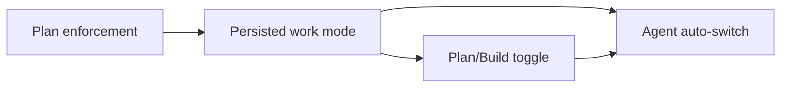

## Outcome
Plan mode isn't read-only today: Pi lets bash, MCP and plugin tools mutate, and Codex has no enforcement (`10-plan-mode-audit.md`). We ship real tool-level enforcement first, then split `plan` out of the approval list into a persisted Plan/Build work mode, a UI toggle, and an agent-driven auto-switch. Decisions (operator, 24 Oct): enforcement first; the agent may enter Plan freely but Plan→Build needs an approved plan unless approval is `auto`; chats saved as `plan` migrate to `workMode: plan` + the Settings default approval.

## Proposed flow


## Plan mode is actually read-only <!-- id: plan-enforcement -->

### Deliverable
A chat in plan mode can read the workspace and write only its plan file, on every harness.

### User story
**As an** operator planning a risky change
**I want** plan mode to block every write except the plan file
**So that** an investigation can never edit code, commit, or call out to the network

### Approach
- One plan capability filter on the shared Pi tool-call path, instead of the plan→auto rewrite.
- Deny-by-default bash allowlist and MCP/plugin classification.
- Codex plan maps to a read-only sandbox; Claude keeps native `--permission-mode plan`.

- [~] Remove the plan→auto rewrite in Pi and route every tool call through one plan filter
  `pi-session-factory.ts:281-284,309,333`, `shared-planning.ts:309`.
- [ ] Allowlist read-only bash commands; deny redirects, `rm`, `git commit/push`, installs, `curl`
- [ ] Deny `mcp_call`, plugin tools and code-intel edit/rename in plan unless known read-only
- [ ] Narrow `isPlanWritePathAllowed` to the active plan file only
- [ ] Make subagents from a plan parent read-only on every launch path
- [ ] Map Codex plan to a read-only sandbox with `approvalPolicy: never`
- [ ] Stop `approvals.ts:76` treating plan as allow

### Technical explanation
Today the plannotator hook (`plannotator-ext/index.ts:1065-1073`) only gates edit/write tools and allows any `.md` in cwd, so `AGENTS.md` is writable and bash is untouched. Putting the guard where all Pi tools dispatch covers registry, managed-file, plugin and MCP tools at once. `direct-native-subagent.ts:23-27` already forces read-only children and is the pattern to reuse.

```diff path=packages/cli-adapters/src/approvals.ts
-  if (mode === "auto" || mode === "plan") return "allow"
+  if (mode === "auto") return "allow"
+  if (mode === "plan") return "deny"
```

### Acceptance
- [ ] Bash `echo x > a.ts`, `rm`, `git commit`, `curl` are denied in Pi plan (test[unit]: packages/cli-adapters/src/runtime/agent/plan-enforcement.test.ts::denies mutating bash in plan)
- [ ] Writing `AGENTS.md` is denied, writing the plan file succeeds (test[unit]: packages/plannotator-ext/tool-scope.test.ts::only the active plan file is writable)
- [ ] Codex plan launches with a read-only sandbox (test[unit]: packages/cli-adapters/src/runtime/codex/runtime.test.ts::plan maps to read-only sandbox)
- [ ] Scripted agent's out-of-plan write is blocked in the app (test[e2e]: apps/desktop/e2e/plan-mode.spec.ts::blocks writes outside the plan file)

### Definition of Done
- Acceptance criteria verified
- Focused tests, typecheck, and lint pass
- Codex sandbox docs cited in the PR

### Files
- `packages/cli-adapters/src/runtime/agent/pi-session-factory.ts` — M
- `packages/cli-adapters/src/runtime/agent/shared-planning.ts` — M
- `packages/plannotator-ext/tool-scope.ts` — M
- `packages/cli-adapters/src/runtime/codex/runtime.ts` — M
- `packages/cli-adapters/src/approvals.ts` — M

> complexity: high

## Work mode survives restarts <!-- id: work-mode-model -->

### Deliverable
Plan/Build is its own persisted per-chat setting, separate from approval level.

### User story
**As an** operator
**I want** a chat left in Plan to still be in Plan after a restart, with my approval level intact
**So that** a crash never silently drops me into a build mode or downgrades auto to accept-edits

### Approach
- Add `WorkMode` and `ApprovalLevel` to `packages/core/src/domain.ts`; drop `plan` from `PermissionMode`.
- Persist `workMode` in `sessions.ts`; delete in-memory `priorModes` and the `exec-mode.ts` restore.
- Plan approval sets `workMode: build` on the server.

- [ ] Add the types and collapse the six duplicated mode/role arrays into one exported constant
- [ ] Persist `workMode` per chat and migrate saved `plan` chats to plan + default approval
- [ ] Add `Agent.setWorkMode` RPC plus a change event in `packages/contracts`
- [ ] Set build on plan approval server-side; remove `SET_MODE auto` at `conversation-machine.ts:1639`

### Technical explanation
`agent-runner.ts:343-357` keeps plan only in a memory Ref, and `sessions.ts:117` coerces unknown strings to `ask`, which is why restarts desync with Plannotator state. Persisting the mode removes the restore logic instead of patching it. Unknown persisted values should fail loudly in the migration test rather than coerce.

### Acceptance
- [ ] A chat saved in Plan reloads in Plan with its approval level (test[unit]: packages/cli-adapters/src/sessions.test.ts::persists work mode across reload)
- [ ] Legacy `plan` chats migrate to plan + default approval (test[unit]: packages/cli-adapters/src/sessions.test.ts::migrates legacy plan mode)
- [ ] Approving a plan switches the chat to Build without touching approval (test[unit]: packages/cli-adapters/src/runtime/agent/shared-planning.test.ts::approval sets build)

### Definition of Done
- Acceptance criteria verified
- Focused tests, typecheck, and lint pass
- Migration fixture committed

### Files
- `packages/core/src/domain.ts` — M
- `packages/cli-adapters/src/sessions.ts` — M
- `packages/cli-adapters/src/agent-runner.ts` — M
- `packages/contracts/src/index.ts` — M
- `apps/desktop/src/renderer/conversation-machine.ts` — M

> complexity: medium
> depends: plan-enforcement

## Plan/Build toggle in the composer <!-- id: plan-build-toggle -->

### Deliverable
The composer shows a Plan/Build toggle beside a separate approval control.

### User story
**As an** operator
**I want** to flip between Plan and Build without changing how often the agent asks me
**So that** I can plan under auto approvals, which today is impossible

### Approach
- Compose the toggle from the cataloged segmented control in `packages/ui`.
- Shift+Tab cycles Plan/Build; approval keeps its own dropdown.
- Remove plan from mode-switch, new-workspace and settings lists.

- [ ] Add the toggle to `composites/composer.tsx` and wire it to `Agent.setWorkMode`
- [ ] Remove plan from `MODE_OPTIONS`, `MODE_CYCLE_WITH_PLAN`, `mode-switch.tsx`, new-workspace and settings
- [ ] Add stories for both states

### Technical explanation
`conversation-view.tsx:135-136` excludes plan from Shift+Tab and `allowPlan` hides it inconsistently; a separate toggle removes both special cases. The toggle reads the persisted `workMode`, so it needs no local state.

### Acceptance
- [ ] Toggling Plan blocks a scripted write and Build allows it (test[e2e]: apps/desktop/e2e/plan-mode.spec.ts::toggle switches plan and build)
- [ ] Shift+Tab cycles Plan/Build (test[unit]: packages/ui/src/app/conversation-view.test.tsx::shift+tab cycles work mode)

### Definition of Done
- Acceptance criteria verified
- Focused tests, typecheck, and lint pass
- Story screenshot compared with the Paper board

### Files
- `packages/ui/src/composites/composer.tsx` — M
- `packages/ui/src/app/conversation-view.tsx` — M
- `packages/ui/src/app/mode-switch.tsx` — M

> complexity: medium
> depends: work-mode-model

## Agent switches Plan/Build itself in Auto <!-- id: agent-auto-switch -->

### Deliverable
In Auto, the agent enters Plan on its own and asks for approval before leaving it.

### User story
**As an** operator
**I want** the agent to drop into Plan when a task is big
**So that** I review risky changes without remembering to toggle

### Approach
- Tool `jingler_set_work_mode({ mode, reason })`, registered only when `autoSwitch` is on.
- `plan` always allowed; `build` requires an approved plan unless approval is `auto`.
- Rendered as a visible tool-call card; rate-limited per turn.

- [ ] Register the tool behind `autoSwitch` and render its card
- [ ] Gate `build` on an approved plan and rate-limit switches per turn

### Technical explanation
No competitor (opencode, T3 Code, Conductor, Claude Code) lets the agent switch on its own (`11-plan-mode-competitors.md`), so the gate is what keeps it safe: leaving Plan goes through the existing `plannotator_submit_plan` review instead of a new approval path.

### Acceptance
- [ ] Entering Plan via the tool succeeds and shows a card (test[e2e]: apps/desktop/e2e/plan-mode.spec.ts::agent enters plan via tool)
- [ ] Switching to Build without an approved plan is refused (test[unit]: packages/cli-adapters/src/runtime/agent/work-mode-tool.test.ts::build needs approved plan)

### Definition of Done
- Acceptance criteria verified
- Focused tests, typecheck, and lint pass
- Tool description reviewed for prompt clarity

### Files
- `packages/cli-adapters/src/runtime/agent/work-mode-tool.ts` — A
- `packages/ui/src/composites/tool-call.tsx` — M

> complexity: medium
> depends: work-mode-model, plan-build-toggle

## Test strategy
- Unit: enforcement matrix per harness (bash write, `rm`, `git commit`, `curl`, MCP mutate, subagent write, non-plan `.md`) plus the migration fixture.
- E2E: `plan-mode.spec.ts` drives blocked writes, the toggle, and agent-initiated switching through the built app.
- Later, not in scope: approve-with-feedback and "approve & review each edit" (Claude Code, Conductor).
