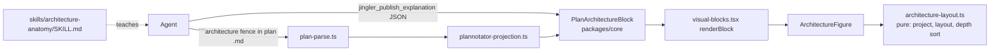

# Architecture Anatomy: a structured `architecture` visual block

Anatomy's one rule is that the object is the explanation. Here's how that rule carries over to software: a system is drawn as a small isometric **bench of real parts** (a store is a stack of platters, a queue is a conveyor lane, a cache is a drawer rack, a gateway is a turnstile arch, and a service is a vented machine block). Parts sit on layer plinths and connect through wires that end on real ports. One part is lit, and it's the subject of the explanation. The agent sends a typed model, never SVG, so output stays safe and looks the same in every session.



## Block shape

```json
{
  "kind": "architecture",
  "id": "checkout",
  "title": "Checkout request path",
  "layers": [{ "id": "edge", "label": "Edge" }, { "id": "app", "label": "App" }, { "id": "data", "label": "Data" }],
  "components": [
    { "id": "gw", "label": "API gateway", "layer": "edge", "shape": "gateway" },
    { "id": "api", "label": "orders-api", "layer": "app", "shape": "service", "detail": "Hono, 3 replicas" },
    { "id": "q", "label": "order-events", "layer": "app", "shape": "queue" },
    { "id": "db", "label": "Postgres", "layer": "data", "shape": "store" }
  ],
  "links": [
    { "from": "gw", "to": "api", "label": "POST /orders", "mode": "sync" },
    { "from": "api", "to": "q", "mode": "async" },
    { "from": "api", "to": "db", "mode": "data" }
  ],
  "lit": "api"
}
```

- `shape`: `client | gateway | service | worker | queue | store | cache | external`.
- `mode`: `sync` (solid wire, request pulse) | `async` (segmented wire, slower pulse) | `data` (thick wire).
- Decoding rejects links or `lit` that point at unknown component ids, components on unknown layers, and duplicate ids. Size caps: 6 layers, 24 components, 40 links.

## Stages

- [x] 1. **Schema.** Add `PlanArchitectureBlock` to the `PlanBlock` union in `packages/core/src/plan-document.ts` (it flows into `VisualBlock` / `ExplanationPayload`, so the explanation tool picks it up for free). Validate references with `Schema.filter`.
- [x] 2. **Layout (pure).** `packages/ui/src/composites/architecture/layout.ts`: iso projection (45°/30°), layers become stacked plinths, components are placed in a grid per layer, links route port to port, back-to-front depth sort. No React.
- [x] 3. **Renderer.** `ArchitectureFigure` puts one solid recipe per shape on a card (title, hint, live readout). Labels go on the plinth front faces, never floating. Pulses run along the wires, and the animation stops under `prefers-reduced-motion`. Hovering or focusing a part lights its links and shows `detail` in the readout. Every part is keyboard-focusable and has an `aria-label`. Colours come only from `--sb-*` tokens. Wired into `renderBlock` in `visual-blocks.tsx`.
- [x] 4. **Plan mode.** Parse ` ```architecture ` fences (JSON body) into the block in `packages/plannotator-ext/plan-parse.ts`, add the kind to `PlannotatorSectionBlock` and map it in `sectionBlockToPlanBlock`. Bad JSON falls back to a plain code block, so a plan never fails to render. Mention the fence in `packages/shared/pfm-reminder.ts` and regenerate. Section level only for v1.
- [x] 5. **Skill.** `skills/architecture-anatomy/SKILL.md` adapts Anatomy's rules for systems: truth first (real components from the repo), pick the lit subject, one sentence for what flows and what it means, a parts list before drawing, lines resolve, and a critic pass. `skills/explain/SKILL.md` points to it for system and architecture questions.
- [x] 6. **Story and e2e.** A Storybook story for the figure, plus `apps/desktop/e2e/architecture-figure.spec.ts`: the scripted agent publishes an explanation and a plan, each with an architecture block, and the spec asserts the parts render, focus shows the detail, and the lit part is marked.

## Test strategy

- `plan-document` / `explanation-document` tests: valid blocks decode, and dangling `from`/`to`/`lit`/`layer` and duplicate ids are rejected.
- `layout.test.ts`: projection maths, deterministic placement, depth order (a back part always paints before a front part), and every link endpoint landing on a port.
- `plan-parse.test.ts`: an architecture fence parses to the block, and bad JSON falls back to a code block. `plannotator-projection.test.ts`: the block maps through.
- `visual-blocks.test.tsx`: renders the figure, hover/focus updates the readout, and reduced motion shows no animation.
- e2e as in stage 6. `pnpm lint && pnpm typecheck && pnpm test` green.

## Skipped for v1

Explode/drag interaction, WebGL, 3D turning, stage-level architecture blocks, and before/after diffs of the architecture. Each can be added later on top of the same schema.
